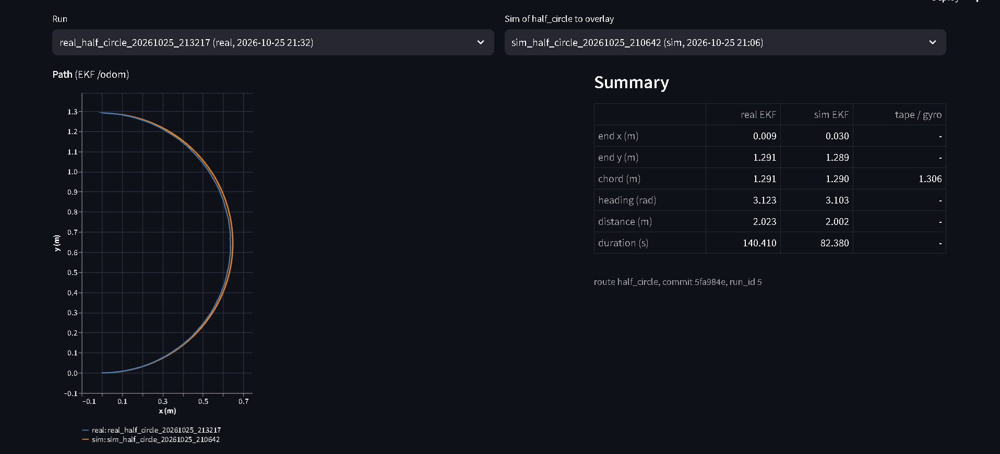
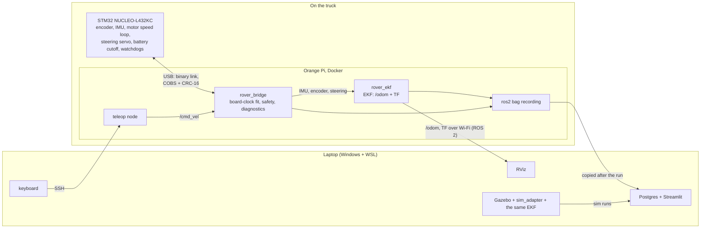

# autonomous-rover

An Axial SCX24 Jeep Wrangler, a [1/24-scale](docs/calibration.md?plain=1#L13) RC crawler, turned into a
small state-estimation testbed: STM32 firmware that drives the truck safely, a ROS 2 bridge and
an Extended Kalman Filter running on the truck, a Gazebo model of the same truck, and recorded
runs in Postgres with a Streamlit dashboard.

Stack: C (STM32), C++17, Python, ROS 2 Jazzy, Gazebo Harmonic, Docker, PostgreSQL, Streamlit, GitHub Actions.

**What it does today**
- Drives by keyboard teleop over Wi-Fi, with a stop path at every layer, from the keyboard down
  to the motor driver.
- Estimates its pose on the truck (EKF: wheel encoder, gyro and the bicycle model), checked
  against a tape measure and against Gazebo's ground truth.
- Records a run, imports it into Postgres, and shows the real and simulated runs on one page.

**What it doesn't do yet:** drive a route by itself. There's no planner or path follower
([What I'd do next](#what-id-do-next)).

## Architecture

The EKF runs on the Pi because its inputs stay off Wi-Fi there
([gaps up to ~600 ms](docs/ros-bridge.md?plain=1#L341) on Wi-Fi). Why this and the other choices:
[docs/design-decisions.md](docs/design-decisions.md).

## Measured results

The truck's runs were driven by teleop and taped by hand. The sim's were scripted in Gazebo and
compared against its ground truth.

| Run | Truth | EKF | Error | Source |
|---|---|---|---|---|
| Truck, straight 2 m | tape 2.073 m | 2.041 m | **−1.5 %** | [kalman-filter.md:295](docs/kalman-filter.md?plain=1#L295) |
| Truck, half circle (Week 6): heading | gyro 2.969 rad | 2.897 rad | **−0.072 rad** | [kalman-filter.md:296](docs/kalman-filter.md?plain=1#L296) |
| Truck, half circle (Week 6): end point | tape chord 1.186 m | 1.258 m | **+7.2 cm** | [kalman-filter.md:297](docs/kalman-filter.md?plain=1#L297) |
| Truck, recorded half circle: chord | tape 1.306 m | 1.291 m | **−1.5 cm** | [kalman-filter.md:315](docs/kalman-filter.md?plain=1#L315) |
| Recorded half circle: truck vs sim end points | | | **2.1 cm** apart | [kalman-filter.md:318](docs/kalman-filter.md?plain=1#L318) |
| Gazebo, straight | 2.0000 m | 2.0000 m | **0.00 %** | [kalman-filter.md:377](docs/kalman-filter.md?plain=1#L377) |
| Gazebo, half circle: heading | 3.0946 rad | 3.0966 rad | **+0.002 rad** | [kalman-filter.md:379](docs/kalman-filter.md?plain=1#L379) |
| Gazebo, half circle: end point | | | **0.6 cm** | [kalman-filter.md:380](docs/kalman-filter.md?plain=1#L380) |

- **The truck's steering spreads from run to run:** the same full-lock command turns a radius of
  [0.595–0.670 m, −7.5 % to +4.2 % against the 0.643 m model](docs/calibration.md?plain=1#L88). The
  Week 6 half circle landed at the tight end ([0.595 m](docs/kalman-filter.md?plain=1#L300)), the recorded
  one near the model ([0.653 m](docs/kalman-filter.md?plain=1#L322)). So the close truck–sim overlay is
  partly luck; the tape is the accuracy check.
- **The Week 6 heading error has a known cause:** in a long steady turn the EKF's heading follows
  the steering model rather than the gyro ([kalman-filter.md:330](docs/kalman-filter.md?plain=1#L330)).
  It's the first item below.

## Safety design

Each layer covers a failure the others can't see ([design decision 5](docs/design-decisions.md#5-layered-stop-paths-each-layer-covers-a-failure-the-others-cant-see)).

- **Teleop deadman:** no key or keepalive for [0.5 s](docs/ros-bridge.md?plain=1#L144): speed 0, latched; for
  [2 s](docs/ros-bridge.md?plain=1#L145): ESTOP.
- **Bridge heartbeat:** no `/cmd_vel` for [300 ms](docs/ros-bridge.md?plain=1#L30): stop; for
  [1 s](docs/ros-bridge.md?plain=1#L31): ESTOP and disarm. This catches a Wi-Fi drop, which the firmware
  can't see.
- **Firmware:** no valid command for [500 ms](firmware/README.md?plain=1#L666): motor driver off and
  latched; no steering command for [500 ms](firmware/README.md?plain=1#L228): servo centred; main loop
  hung: the hardware watchdog resets the MCU after [250 ms](firmware/README.md?plain=1#L1320).
- **Battery:** below [6.6 V for 3 s](firmware/README.md?plain=1#L496), the motor is locked out until
  reset; the Pi [shuts itself down](docs/ros-bridge.md?plain=1#L233) when the pack is flat at rest.

## Testing

| Suite | What it covers |
|---|---|
| C++ core (GoogleTest) | bicycle model, EKF, `vehicle.cfg` parser, the EKF node's input side; [8 system tests](docs/kalman-filter.md?plain=1#L189): NEES/NIS consistency, beating dead reckoning, tire scrub |
| Firmware (host-tested C) | each pure-C module built for the host with sanitizers ([Host tests](firmware/README.md?plain=1#L1899)) |
| Python tools and bridge | the link, conversions, clock fit, safety, teleop, shutdown watcher, without ROS |
| ROS node tests | the bridge and the EKF node, running: [174 and 1 tests](docs/ros-bridge.md?plain=1#L703) in CI |
| Telemetry | [23 unit tests](docs/telemetry.md?plain=1#L167) without a database, [7 integration tests](docs/telemetry.md?plain=1#L170) against Postgres |

**Mutation testing** plants one bug at a time and requires a test to fail: the link,
[88 of 88 killed](firmware/README.md?plain=1#L2003); the bridge, [96 of 97](docs/ros-bridge.md?plain=1#L713)
killed and the one control (a comment-only change) survived, as it must.

**CI**, four jobs on every push: `build-and-test` (C++, warnings as errors), `python-tests`,
`ros-tests` (a `ros:jazzy` container, colcon), and `telemetry-db` (a Postgres 16 service). The
two newest, `ros-tests` and `telemetry-db`, were first shown to fail on a deliberately broken copy
([design decision 10](docs/design-decisions.md#10-failure-controls-each-new-ci-check-is-shown-to-fail-before-its-trusted)).

## How to run

Build and test the ROS-free parts (CMake and a C++17 compiler; the first configure downloads
GoogleTest):

    cmake -S . -B build -DROVER_WARNINGS_AS_ERRORS=ON
    cmake --build build --parallel
    ctest --test-dir build --output-on-failure
    python3 -m pytest -q tools ros_ws/src/rover_description/test ros_ws/src/rover_bridge/test

- **The sim** (WSL, ROS 2 Jazzy, Gazebo Harmonic): [kalman-filter.md, "Running it"](docs/kalman-filter.md?plain=1#L397).
- **The truck** (the Pi's setup, then the bridge, EKF and teleop):
  [ros-bridge.md, "Setup on the Pi"](docs/ros-bridge.md?plain=1#L645) and ["Run"](docs/ros-bridge.md?plain=1#L663).
- **The dashboard:** `tools/dashboard.sh`, then http://127.0.0.1:8501
  ([telemetry.md](docs/telemetry.md?plain=1#L85)).

## What I'd do next

From the [backlog](docs/project-plan.md?plain=1#L99):

1. **Fix the heading in long turns:** let the gyro, not the steering model, carry the heading
   when the two disagree for many seconds ([kalman-filter.md:330](docs/kalman-filter.md?plain=1#L330)).
2. **Autonomous route following:** a path follower, so the truck can drive a route by itself
   ([project-plan.md:103](docs/project-plan.md?plain=1#L103)).
3. **External ground truth**, such as an overhead ArUco camera: today truth is a tape measure at
   the end of a run ([project-plan.md:108](docs/project-plan.md?plain=1#L108)).
4. **A headless Gazebo route check in CI**, deferred for its cost
   ([project-plan.md:110](docs/project-plan.md?plain=1#L110)).

## Docs

| Doc | For |
|---|---|
| [design-decisions.md](docs/design-decisions.md) | ten decisions, why, and what was measured: start here |
| [kalman-filter.md](docs/kalman-filter.md) | the EKF's math, the gyro noise, the truck and sim results |
| [ros-bridge.md](docs/ros-bridge.md) | the bridge, safety, teleop, low-battery shutdown, the EKF node |
| [firmware/README.md](firmware/README.md) | the firmware, the binary link, its tests |
| [telemetry.md](docs/telemetry.md) | recording, import, the schema, the page |
| [calibration.md](docs/calibration.md) | how each `vehicle.cfg` value was measured |
| [project-plan.md](docs/project-plan.md) | plan vs actual per week, and the backlog |

## How it was built

Built with an AI coding assistant (Claude Code) as a tool: I specified each step, reviewed every
change, and verified the results on the truck.

Developed in a private repository; history condensed for publication. Full history available on request.
