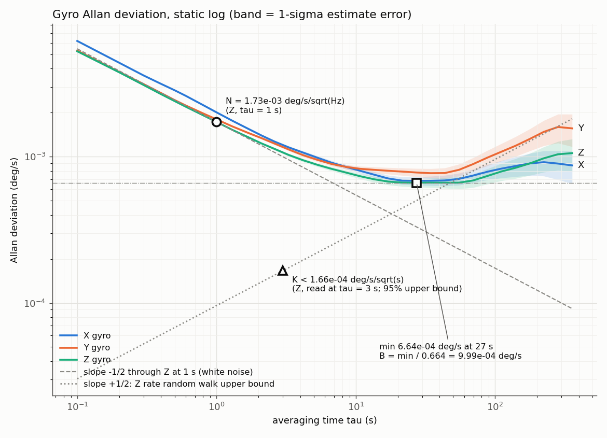
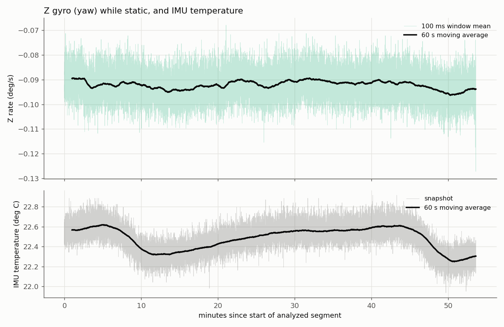

# Extended Kalman Filter — design

The rover estimates its own pose from a wheel encoder and a gyro, fused with the
bicycle model as a soft constraint. This doc is the source of truth for the math;
the C++ implementation must match it term for term.

## What the filter can and cannot do

The rover only senses itself (proprioception): wheel speed and rotation rate.
Nothing measures absolute position, so:

- heading and speed are estimated much better than by either sensor alone,
- the gyro bias is learned continuously (it drifts with temperature),
- **x/y still drift slowly** — no filter can remove that without an external
  reference (e.g. an overhead ArUco camera, not built). This is an observability limit, not a bug.

Out of scope for v1: accelerometer (integrating it for speed drifts; the encoder
measures speed directly) and 3D/tilt (the course is a flat floor).

## State (6 values)

| # | Name | Unit | Meaning |
|---|---|---|---|
| 0 | x | m | position, world frame |
| 1 | y | m | position, world frame |
| 2 | heading | rad | yaw, normalized to (−π, π] |
| 3 | speed | m/s | forward speed of the rear-axle center |
| 4 | yaw_rate | rad/s | true rotation rate |
| 5 | gyro_bias | rad/s | gyro z-axis offset |

The reference point is the rear-axle center, same as `BicycleModel` and the URDF `base_link`.

### Initialization

The filter has no default state: the constructor takes the initial state and
initial covariance P₀ alongside the wheelbase and noise parameters. There is no
sensible default uncertainty, so the caller must state one (e.g. x, y, heading
≈ 0 with tiny variance when the world frame is defined by the start pose; speed
and yaw_rate ≈ 0 when starting at rest; gyro_bias with a variance covering the
sensor's datasheet offset range). `reset()` re-initializes a running filter the
same way (e.g. after the rover is picked up and placed somewhere known).

Both the constructor and `reset()` reject: any non-finite value, a covariance
that is not symmetric (relative comparison with its transpose), or a covariance
that is not positive semi-definite (smallest eigenvalue < −1e-12·max|P₀|, the
margin allowing for rounding). A rejected `reset()` leaves the filter
unchanged. The initial heading is normalized to (−π, π].

### Why yaw_rate is a state (design history)

A first draft used 5 states and predicted heading from the steering model only.
Flaw: the gyro then had no path to correct heading. If the real truck turns less
than the model (tire scrub), the filter would blame the difference on gyro bias,
corrupting the bias estimate while heading stayed wrong. With yaw_rate in the
state, the gyro measures rotation directly and the steering model becomes a
loose hint.

## Predict step

Model: speed and yaw rate are roughly constant over one step of length dt.

```
heading_mid = heading + yaw_rate·dt/2
x'          = x + speed·dt·cos(heading_mid)
y'          = y + speed·dt·sin(heading_mid)
heading'    = normalize(heading + yaw_rate·dt)
speed'      = speed
yaw_rate'   = yaw_rate
gyro_bias'  = gyro_bias
```

**Why midpoint heading instead of Week 1's exact arc:** the arc formula divides by
yaw_rate (needs a straight-line special case) and has a messier Jacobian. The
midpoint form matches the arc's chord to within a relative error of about
(yaw_rate·dt)²/24 — ~2e-5 at 1.9 rad/s and dt = 10 ms — far below sensor noise.

dt rules match `BicycleModel`: dt = 0 is a no-op; negative, NaN or infinite dt throws.

### Covariance

```
P' = F·P·Fᵀ + Q
```

F = ∂f/∂state (identity plus these entries):

```
∂x'/∂heading        = −speed·dt·sin(heading_mid)
∂x'/∂speed          =  dt·cos(heading_mid)
∂x'/∂yaw_rate       = −speed·dt·sin(heading_mid)·dt/2
∂y'/∂heading        =  speed·dt·cos(heading_mid)
∂y'/∂speed          =  dt·sin(heading_mid)
∂y'/∂yaw_rate       =  speed·dt·cos(heading_mid)·dt/2
∂heading'/∂yaw_rate =  dt
```

Q = diag(q_x, q_y, q_heading, q_speed, q_yaw_rate, q_gyro_bias) · dt.
Each q is a variance growth rate (per second), so tuning does not depend on the loop rate.

- q_speed, q_yaw_rate: large-ish — throttle and steering change these at will.
- q_gyro_bias: very small — bias drifts slowly (temperature).
- q_x, q_y, q_heading: small — model imperfections beyond speed/yaw_rate.

## Measurement updates

All three are scalar. Apply whichever arrived this cycle, in any order, so
sensors at different rates need no special handling.

| Update | Measurement z | Prediction h(state) | H |
|---|---|---|---|
| Encoder | measured speed | speed | [0 0 0 1 0 0] |
| Gyro | measured z-rotation | yaw_rate + gyro_bias | [0 0 0 0 1 1] |
| Steering model | 0 | yaw_rate − k·speed | [0 0 0 −k 1 0] |

where k = tan(δ)/wheelbase and δ is the commanded (effective) steering angle.

### The steering-model pseudo-measurement

The bicycle model says yaw_rate ≈ k·speed. It is used as a measurement of the
*difference*, with a noise level that depends on the situation:

```
sigma_steer = sigma_steer_min + sigma_steer_relative·|k·speed|
R_steer     = sigma_steer²
```

- Stopped (speed ≈ 0) or straight (k = 0): tight — the truck cannot be rotating.
- Turning: loose — scrub makes the model imprecise.

`speed` in sigma_steer is the filter's **current speed estimate** (the state
before this update), since that is the only speed the filter has. Using the
estimate makes R depend on the state, which is a standard EKF approximation;
it only sets how loose the hint is, not the prediction h(state).

δ must be finite and satisfy |δ| < π/2 — tan(δ) is infinite at ±π/2, and any
real steering angle is far inside that. Out-of-range or non-finite δ is
rejected (throws) and the filter is left unchanged.

**This is what makes gyro bias observable.** The gyro reports
`true rotation + bias`: one number, two unknowns. The steering model is a second,
independent opinion on true rotation. When stopped or driving straight it says
"≈ 0", so whatever the gyro reads is bias (like reading an empty kitchen scale
to find its offset).

**Not while stopped (OdometryFusion, 2026-10-25).** The rover's input side skips
the steering update while the encoder reads at rest (|v| < 5 mm/s). Stopped,
"≈ 0" is wrong whenever the truck is turned by hand or set down facing
elsewhere: on the bench a 90° hand turn showed as 0.75 of the turn, then decayed
~0.015 rad/s. The bias absorbed the rotation (+0.025 rad/s), and through the
heading–bias covariance built up at rest the update also took heading off
directly. Bias tracking now comes from the 2 s seed and from driving straight.

**Known cost under tire scrub — watch and tune in the Week 6 real-vs-sim test.**
When the real truck turns less than the command, the steering residual is
nonzero during turns. H_steer = [0 0 0 −k 1 0] has −k in the speed column, so
part of that residual is explained away by lowering the *speed* estimate, not
only by yaw_rate. In simulation with 10% scrub and the placeholder
sigma_steer_relative = 0.2, the filter under-estimates distance travelled in
turns by ~0.8% (speed biased ~0.0025 m/s low at 0.3 m/s cruise). Heading and
gyro bias are unaffected — the gyro drives those. The effect grows quickly as
sigma_steer_relative shrinks (at 0.02 the course's final position error was
~0.12 m vs ~0.016 m). Tuning sigma_steer_relative against real scrub is the
lever; `ExtendedKalmanFilterRealisticDrive.TireScrubDoesNotCorruptSpeed` checks
that speed error in turns stays within what encoder noise alone explains.

### Update equations

```
residual = z − h(state)
S        = H·P·Hᵀ + R                     (scalar)
K        = P·Hᵀ / S                       (6×1, a division — no matrix inverse)
state   += K·residual                     (then re-normalize heading)
P        = (I − K·H)·P·(I − K·H)ᵀ + K·R·Kᵀ   (Joseph form)
```

Joseph form keeps P symmetric and positive semi-definite despite rounding,
unlike the shorter P = (I − K·H)·P.

No residual involves heading, so no angle wrapping is needed in residuals.

## Verification plan

Unit level:
- analytical F vs a finite-difference Jacobian at many states (catches math typos),
- straight line and constant turn with zero noise match the closed form,
- P stays symmetric and positive semi-definite,
- stationary truck with a constant gyro offset → gyro_bias converges to it, yaw_rate → 0.

System level (`tests/test_extended_kalman_filter_system.cpp`, 8 tests: NEES/NIS consistency, and a realistic drive that must beat dead reckoning, converge the bias and survive tire scrub):
- ground truth from `BicycleModel`, synthetic encoder/gyro with seeded noise and bias,
- filter error < dead-reckoning error,
- consistency: NEES (normalized estimation error squared) averages near the state
  dimension over Monte Carlo runs — the filter's reported uncertainty matches its real error.

## Parameters

The core's default noise values are labeled placeholders; the system tests keep their own.
The ROS node on the truck sets its own values, above the static log's figures, for the
reasons in [Measured gyro noise](#measured-gyro-noise-static-2026-10-04--lower-bounds)
below ("In use since group 6").

Which values may be zero, and why (all must be finite; the constructor throws
otherwise):

| Parameter | Allowed | Why |
|---|---|---|
| wheelbase | > 0 | k = tan(δ)/wheelbase divides by it |
| q_x, q_y, q_heading, q_speed, q_yaw_rate, q_gyro_bias | ≥ 0 | Zero just means "the model is exact for this state" — P can still grow through F. Tests use all-zero Q to compare against closed forms. |
| encoder speed variance (R_encoder) | > 0 | R is the only thing keeping S = H·P·Hᵀ + R above zero when P is (nearly) zero in the measured direction; K = P·Hᵀ/S would divide by zero. |
| gyro variance (R_gyro) | > 0 | Same reason. |
| sigma_steer_min | > 0 | When stopped or straight (k·speed = 0), R_steer = sigma_steer_min², so it plays the same role as the sensor variances. |
| sigma_steer_relative | ≥ 0 | Zero means "no extra looseness while turning"; sigma_min still keeps R_steer > 0. |

Measurement inputs (measured speed, measured z-rotation, δ) and dt must be
finite; see the predict and steering-model sections for the other limits.

## Measured gyro noise (static, 2026-10-04) — lower bounds

The EKF's gyro noise values in code are still placeholders. This section records what a one-hour static log measured, what EKF values those measurements suggest, and why they are not applied yet.

### Setup

- Log: `gyro_static_1h.log` (kept outside the repo in `rover-logs/`). 63.6 min at 10 Hz telemetry: 38,165 lines, 0 malformed, 0 timestamp gaps, every window had `n_imu = 100`, and every firmware error counter stayed at 0.
- Truck at rest on a table, battery off, Nucleo powered over USB, IMU at ~22.3–22.6 °C. Logging started ~4 min after boot.
- IMU: ICM-42688-P, ±500 dps, 1 kHz ODR, low-noise mode. Firmware sums 100 samples per 100 ms window. The analysis uses the window means (τ₀ = 0.1 s).
- **The first 600 s are excluded.** During the first ~3 min, Z showed spikes up to ±0.1 °/s. The cause was found: someone was typing on a laptop at the same table, and the vibration reached the sprung chassis. It was not sensor warm-up. Including that period raises ADEV(0.1 s) by 26% and leaves N and B almost unchanged. **For future static logs, put the truck on a surface nobody touches.**
- Tool: `python3 tools/analyze_static_imu.py <log> --skip-start-seconds 600`. It computes the overlapping Allan deviation with numpy and has 15 pytest tests, with tolerances derived from a 200-seed Monte Carlo.

### Results (Z = yaw, the only gyro axis the EKF uses)

| Quantity | Value | rad units |
|---|---|---|
| Mean bias | −0.0921 °/s | −1.61e-3 rad/s |
| Bias change, last 10 min − first 10 min | −0.0024 °/s | −4.1e-5 rad/s |
| Std of one 1 kHz sample | 0.0354 °/s | 6.2e-4 rad/s |
| ADEV(0.1 s), noise of one 100 ms mean | 0.00526 °/s | 9.2e-5 rad/s |
| ADEV(0.1 s) ÷ (sample std / √100) | 1.49 | — |
| **N**, angle random walk (read at τ = 1 s) | 0.00173 °/s/√Hz (0.104 °/√h) | 3.02e-5 rad/s/√Hz |
| **B**, bias instability (Allan minimum ÷ 0.664, at τ ≈ 27 s) | 0.00100 °/s (3.6 °/h) | 1.74e-5 rad/s |
| **K**, rate random walk | not resolved; 95% upper bound ≤ 1.66e-4 °/s/√s | ≤ 2.90e-6 rad/s/√s |
| Z bias vs temperature | 0.0115 ± 0.0013 °/s per °C (r = 0.79) | 2.0e-4 rad/s per °C |

X and Y for reference: bias −0.169 and −0.493 °/s; N 0.0020 and 0.0018 °/s/√Hz; B 0.0010 and 0.0012 °/s.

The datasheet typical noise density is 2.8 mdps/√Hz. The measured N is comparable to that. *(A tighter "at or below typical" claim needs confirmation that both numbers use the same one-sided noise-density convention.)*

Method references: IEEE Std 952-1997 (Allan variance appendix) for the N/B/K definitions and the 0.664 factor; NIST SP 1065 for the overlapping Allan deviation and its confidence intervals.



### What the data shows

- **Neighboring 1 kHz samples are correlated.** If samples were independent, the noise of a 100-sample mean would be the sample std ÷ 10. It is about 1.5× that on all three axes (1.51, 1.54, 1.49), which is consistent with the IMU's internal low-pass filter. **Consequence:** R must come from N (or from ADEV at the feed interval), not from the raw sample variance. The raw variance would make the filter trust each sample about 2.4× too much.
- **The long-τ tail is temperature, not a random walk.** After the minimum at ~27 s, the Z curve rises and then flattens or falls. The room temperature cycled with a period of about 38 min (span 0.37 °C), and the Z bias tracked it: each temperature drop moved the bias more negative by about the amount the 0.0115 °/s/°C slope predicts. So K is reported only as an upper bound. Y does show a +1/2 slope region, but it is probably the same temperature effect. The EKF does not use Y.



### Proposed EKF values (static)

| Parameter (code name) | Placeholder | Proposed from static data | How |
|---|---|---|---|
| R_gyro (`gyroYawRateVariance`), 10 Hz window means | 1e-4 (rad/s)² | **≈ 9e-9 (rad/s)²** (σ ≈ 0.0055 °/s) | N² / T with T = 0.1 s; directly measured ADEV(0.1 s)² = 8.4e-9 |
| R_gyro, if fed raw 1 kHz samples | 1e-4 (rad/s)² | **≈ 9e-7 (rad/s)²** | N² / T with T = 0.001 s; *not* the raw sample variance 3.8e-7 |
| q_gyro_bias (`processGyroBiasVariancePerSecond`) | 1e-8 (rad/s)²/s | **≈ 1e-11 (rad/s)²/s** | K-bound² ≤ 8.4e-12; B²/τ_min ≈ 1.1e-11 (rule of thumb) |

- R_gyro is a variance per measurement, so its value depends on the feed rate. The feed rate is decided by the Nucleo ↔ Pi protocol. Both rows carry the same information per second.
- The placeholder R is about 11,000× the measured 10 Hz value. The placeholder q is about 1000× too large: the filter would re-learn the bias with a time constant around 0.3 s (ideal-case N/√q) instead of ~10 s. That gives a noisier heading and lets the bias state absorb steering-model mismatch in turns.
- Sanity check on q = 1e-11: it allows about 1.8e-4 rad/s of bias wander over the 53.6 min analyzed, versus 4.1e-5 measured, a ~4× margin.

### Why they are not applied as measured

1. **They are lower bounds.** This was a static log. Motor and drivetrain vibration will raise the short-τ noise, possibly by orders of magnitude. Typing at the table alone raised ADEV(0.1 s) by 26%.
2. **Changing R by ~11,000× moves the balance** between the gyro and the steering model, and the EKF system tests' derived tolerances depend on that balance.
3. **q depends on temperature.** q = 1e-11 only covers roughly 1 °C/h of drift. The electronics will warm up while driving, so q may need to grow toward ~1e-9 (what a ~10 °C/h warm-up would need, since q scales with the square of the drift rate; a rough guess until measured), or the bias needs a temperature term.

**In use since group 6** (the ROS node, `ros_ws/src/rover_ekf`, at the bridge's 100 Hz feed): R_gyro = 1e-6
and q_gyro_bias = 1e-9, both above the static figures for the reasons above; the steering model's noise
from the 2026-10-22 full-lock spread (docs/ros-bridge.md, EKF and pose). The system tests keep their own values.

### Next measurements

- A driving log gives R_gyro with vibration and q_gyro_bias with warm-up. Ideally also take a cold-start, motor-running warm-up log, with the truck on its own surface.
- Decide the gyro feed rate (Pi protocol), then pick the matching R_gyro form above.

## Real-drive results (Week 6, 2026-10-25)

Clean runs on the truck after the two fixes of that day: no steering model
while the encoder reads at rest, and `rear_axle_locked = true` (the encoder
wheel reads the rear-axle centre's speed). The EKF ran on the Pi with the node
values above. "Gyro" means the raw /rover/imu/raw z integrated minus the seeded
bias (`tools/gyro_turn_check.py`).

| Run | Truth | EKF | Error |
|---|---|---|---|
| Straight 2 m at 0.10 m/s | tape 2.073 m | 2.041 m | −1.5 % (encoder scale confirmed, docs/calibration.md) |
| Half circle, full left, 0.05 m/s: heading | gyro 2.969 rad | 2.897 rad | −0.072 rad (−2.4 %) |
| Half circle: end point | tape 1.186 m (rear-hub chord average) | 1.258 m | +7.2 cm |
| Hand turn at rest (90°, straight edge) | gyro 1.543 rad | 1.539 rad | −0.004 rad, flat afterwards |

- The end-point error matches the turn itself. This run's effective radius was 0.595 m
  (δ ≈ 0.220), while the filter's model uses 0.204 (R ≈ 0.65 m). An earlier run that day
  gave 0.64 m: the steering spreads ~7 % from run to run (docs/calibration.md).
- The hand turn now holds: before the fix the same turn showed 0.75 of the
  rotation and then decayed ~0.015 rad/s (see "Not while stopped" above).

### Recorded half circle (2026-10-25, telemetry)

The first run recorded with `tools/record_run.sh` and imported into Postgres (docs/telemetry.md):
the half circle on the truck (run 5, `real_half_circle_20261025_213217`) and the same route in
Gazebo (run 4, `sim_half_circle_20261025_210642`), both with the code of 2026-10-25. The numbers are the EKF's
last `/odom` sample of each run, read from the database.

| | Truth | EKF | Error |
|---|---|---|---|
| Real: chord (start to end point) | tape 1.306 m (average of the two rear-hub chords) | 1.291 m | −1.5 cm (−1.2 %) |
| Real: heading | none this run (no gyro reference recorded) | 3.123 rad | |
| Sim: heading | | 3.103 rad | |
| Real vs sim: end points | | | 2.1 cm apart |

- **The tape is the accuracy check; the real–sim overlay is partly steering luck.** This run's
  effective radius, from the taped chord and the EKF's heading (c = 2R·sin(θ/2)), was about
  **0.653 m**, within 2 % of the model's 0.643 m. The observed spread is 0.595–0.670 m
  (docs/calibration.md), and the sim always turns the model's radius, so how close a real run
  ends to the sim's depends on where in that spread it lands.
- The earlier half circle of the same day (table above, +7.2 cm) had a radius of 0.595 m: the
  far end of that spread.

### Backlog (no fix yet)

1. **In a long steady turn the heading follows the model, not the gyro.** On the
   half circle the EKF's heading rate sat near k_cfg·v = 0.0783 rad/s rather than
   the gyro's 0.0802. The gyro measures ω + bias, and the steering model says
   ω = k_cfg·v. When the two disagree for many seconds, the bias state absorbs
   the gap, and ω follows the model. Over the half circle that is the −0.072 rad
   above, and it grows with the length of the turn, so it matters on longer
   routes. Candidates: a smaller q_gyro_bias, a looser steering model at full
   lock (the ~7 % spread is larger than the 0.0675 relative noise assumes), or
   freezing the bias while |k·v| is large.
2. **`tools/gyro_turn_check.py` prints a pybind11 RuntimeError traceback on
   Ctrl-C**, after the summary. It is a shutdown race between rclpy's signal
   handling and `destroy_node`/`try_shutdown`. The numbers are unaffected.

## Real vs sim (Week 6 step 3)

The same two routes in Gazebo, with the same EKF node, compared against the
physics engine's ground truth. The question: is the sim a faithful nominal model,
with the real errors explained by what the sim leaves out?

- **The sim's inputs** (`ros2 launch rover_gazebo sim_ekf.launch.py`):
  - a 100 Hz IMU in the model, on `/rover/imu/raw`, with yaw-rate noise from the static log and a
    0.0026 rad/s bias (gz-sensors picks its sign at random per run);
  - `rover_bridge`'s `sim_adapter`: `/rover/joint_states` from the rear-left wheel joint in
    the bridge's encoder units, and `/rover/steering` from `/cmd_vel` with the bridge's own
    rules (whole percent, held while the speed is sent as 0, centred after the 0.3 s
    heartbeat stop);
  - the EKF with `rear_axle_locked` false: the model's AckermannSteering drives its wheels
    like an ideal differential, so the open formula is the right physics there. 0.204 rad
    already includes the real truck's scrub.
- **The routes** (`tools/sim_route.py`, scripted `/cmd_vel` at 20 Hz on sim time, after the
  EKF has started and been reset): the 2 m straight at 0.10 m/s, and the full-lock left half
  circle at 0.05 m/s for π / (v·tan 0.204 / L) = 40.4 s. The printed summary is the record.
- **Pass tolerances:**

| Check | Tolerance | Why |
|---|---|---|
| Straight: sim EKF distance vs truth | within 1 % | no scale error in the sim |
| Straight: sim vs real error | within 3 % | the real bench's pass |
| Half circle: truth's effective radius vs the model's 0.643 m | within **10 %** | set from the observed real spread, 0.595-0.670 m (−7.5 % to +4.2 %); ±7 % would fail a real run |
| Half circle: sim EKF heading vs truth | within 0.03 rad | |
| Half circle: sim EKF end point vs truth | within 3 cm | |
| Half circle: real and sim | heading within 0.1 rad, end point within 10 cm | the real bench's pass |

### First results (2026-10-25)

| Run | Truth | EKF | Error | Real |
|---|---|---|---|---|
| Straight | 2.0000 m | 2.0000 m | 0.00 % | −1.5 % |
| Half circle: radius | 0.646 m (+0.5 % vs model) | | | 0.595-0.670 m |
| Half circle: heading | 3.0946 rad | 3.0966 rad | +0.002 rad | −0.072 rad |
| Half circle: end point | | | 0.6 cm | 7.2 cm |

All checks pass. The first half circle missed the end-point check (4.4 cm): AckermannSteering's
default steer_p_gain of 1.0 lags the steering joints by about 1 s. During that lag the model
went straight for ~5 cm while `/rover/steering` already said full lock, so the
truth turned only 3.03 rad. At 10 (about 0.1 s, close to the real servo) it is fixed
(rover.gazebo.xacro).

**Why the sim's errors are smaller than the real ones:**
- no run-to-run steering spread: the sim turns the model's radius every time;
- no four-wheel fight: the real truck has one motor and a locked centre, front and rear
  axle (vehicle.cfg). In tight turns all wheels are forced to one speed while the front runs
  a larger radius, so the encoder over-reads ground speed by a few %. The sim's wheels are
  driven like an ideal differential;
- so no model/gyro mismatch for the bias to absorb (backlog item 1 above), which is the real
  run's −0.072 rad.

### Running it (WSL, the laptop)

The workspace (once, or after a C++ or entry-point change):

    source /opt/ros/jazzy/setup.bash && mkdir -p ~/sim_ws && cd ~/sim_ws && colcon build --symlink-install --base-paths /mnt/c/DEV/autonomous-rover/ros_ws/src --packages-select rover_description rover_gazebo rover_ekf rover_bridge

Every window first isolates ROS from the Pi: `~/.bashrc` sources `rover_net.sh` (domain 42,
the Pi as a static peer), so these exports override it, and the sim's `/odom` can't mix with
the truck's.

Window 1, the sim and the EKF (wait for `started: gyro bias`; drop `headless:=true` for the GUI):

    source ~/sim_ws/install/setup.bash && export ROS_DOMAIN_ID=77 ROS_AUTOMATIC_DISCOVERY_RANGE=LOCALHOST GZ_IP=127.0.0.1 && unset ROS_STATIC_PEERS && ros2 daemon start && ros2 launch rover_gazebo sim_ekf.launch.py headless:=true

Window 2, one route per command (each resets the EKF and works from wherever the model stands):

    source ~/sim_ws/install/setup.bash && export ROS_DOMAIN_ID=77 ROS_AUTOMATIC_DISCOVERY_RANGE=LOCALHOST GZ_IP=127.0.0.1 && unset ROS_STATIC_PEERS && cd /mnt/c/DEV/autonomous-rover && python3 tools/sim_route.py straight
    source ~/sim_ws/install/setup.bash && export ROS_DOMAIN_ID=77 ROS_AUTOMATIC_DISCOVERY_RANGE=LOCALHOST GZ_IP=127.0.0.1 && unset ROS_STATIC_PEERS && cd /mnt/c/DEV/autonomous-rover && python3 tools/sim_route.py half_circle
